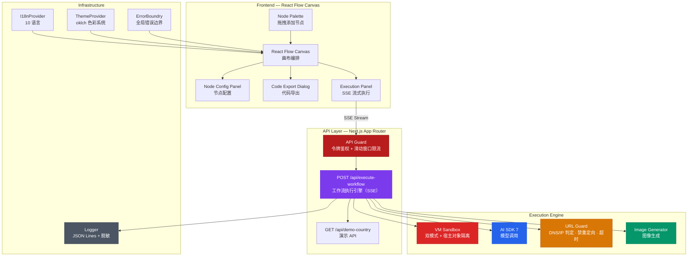
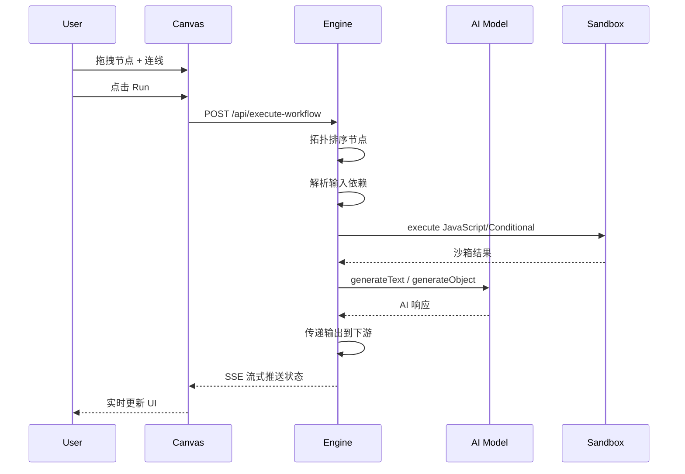

<div align="center">
  <picture>
    <source media="(prefers-color-scheme: dark)" srcset="./public/Family-002.png" />
    
  </picture>
</div>

<br />

<div align="center">

# YYC³ Agent Builder — Visual AI Workflow Builder

**CloudPivot Intelli-Matrix** · 言启千行代码，语枢万物智能

[]()
[]()
[]()
[]()
[]()

[]()
[]()
[]()
[]()
[]()
[]()

[](https://agent.yyc3.vip)
[](./CHANGELOG.md)

<br />

</div>

---

## 🚀 快速导航

| 章节 | 内容 |
|------|------|
| [✨ 概述](#-概述) | 项目定位与核心能力 |
| [📊 架构设计](#-架构设计) | 系统架构与数据流 |
| [🛠️ 技术栈](#️-技术栈) | 完整技术栈快照 |
| [📂 项目结构](#-项目结构) | 代码目录组织 |
| [⚡ 快速开始](#-快速开始) | 环境搭建与运行 |
| [🧩 核心功能](#-核心功能) | 节点系统与特性矩阵 |
| [📈 项目指标](#-项目指标) | 代码质量与规模量化 |
| [🌐 国际化](#-国际化) | 10 语言支持说明 |
| [🔧 配置参考](#-配置参考) | 环境变量与配置 |
| [🔐 安全与部署约束](#-安全与部署约束) | 鉴权、SSRF、部署限制 |
| [📚 文档与变更](#-文档与变更) | 会话文档、日志机制与变更日志 |
| [🔄 CI/CD](#-cicd) | 自动化流水线 |

---

## ✨ 概述

**YYC³ Agent Builder** 是一个基于 **Next.js 16** + **React 19** + **React Flow** 构建的**可视化 AI 工作流编排平台**，支持拖拽式节点编排、实时流式执行、一键代码导出和 10 种语言国际化。

### 核心能力

- **🧩 可视化编排** — 拖拽 12 种节点 + 连线构建 AI 工作流
- **⚡ 实时执行** — SSE 流式执行引擎，实时反馈节点状态
- **🔌 多模型支持** — OpenAI GPT / Google Gemini / Anthropic Claude / xAI Grok
- **🔀 条件分支** — JavaScript 条件表达式，TRUE/FALSE 双路径
- **🌐 HTTP 集成** — 请求外部 API，支持变量插值
- **💻 自定义代码** — 在隔离 VM 沙箱中执行 JavaScript
- **📤 代码导出** — 一键生成 AI SDK 生产级代码
- **🌍 国际化** — 10 种语言，含阿拉伯语 RTL 支持

---

## 📊 架构设计



### 执行流程



---

## 🛠️ 技术栈

| 类别 | 技术 | 版本 | 说明 |
|------|------|------|------|
| **框架** | [Next.js](https://nextjs.org) (App Router) | 16.4.2 | React 全栈框架 |
| **UI 引擎** | [React](https://react.dev) | 19.1.0 | 声明式 UI |
| **组件库** | [shadcn/ui](https://ui.shadcn.com) (new-york) | — | 56 个 Radix UI 组件 |
| **原语** | [Radix UI](https://radix-ui.com) | 精确锁定（见 `package.json`） | 无障碍 UI 原语 |
| **样式** | [Tailwind CSS](https://tailwindcss.com) v4 + oklch | 4.1.9 | 原子化 CSS |
| **流程图** | [@xyflow/react](https://xyflow.com) (React Flow) | 12.12.0 | 节点编辑器 |
| **AI SDK** | [Vercel AI SDK](https://sdk.vercel.ai) (`ai`) | 7.0.142 | 统一 AI 调用 |
| **AI Provider** | `@ai-sdk/google` / `@ai-sdk/openai` / `@ai-sdk/anthropic` | 4.0.98 / 3.0.87 / 3.x | 多模型支持 |
| **表单 + 验证** | react-hook-form + [zod](https://zod.dev) | 7.60 / 4.4.3 | 输入验证 |
| **i18n** | `@yyc3/i18n-core` | ^2.4.0 | 10 语言国际化 |
| **测试** | [vitest](https://vitest.dev) + [@testing-library/react](https://testing-library.com) | 5.0.1 | 单元 + 组件 + API 路由测试 |
| **包管理** | [pnpm](https://pnpm.io) | 11 | 快速、磁盘高效 |
| **语言** | [TypeScript](https://typescriptlang.org) | 5.x | strict 严格模式 |

> 版本以 `package.json` + `pnpm-lock.yaml` 实测为准；v0.1.1 起所有 `latest` 依赖已钉死为精确版本。

---

## 📂 项目结构

```
yyc3-agent-builder/
├── app/                          # Next.js App Router
│   ├── api/
│   │   ├── demo-country/         # 演示 API
│   │   ├── execute-workflow/     # 执行 API（鉴权 + 校验 + SSE 壳）
│   │   └── health/               # 容器健康检查
│   ├── globals.css               # 全局样式 + oklch 主题变量
│   ├── layout.tsx                # 根布局（元数据 + Provider）
│   ├── opengraph-image.tsx       # OG 图片生成
│   └── page.tsx                  # 主页面（React Flow 画布）
├── components/
│   ├── nodes/                    # 12 种工作流节点组件
│   │   ├── start-node.tsx        # 入口节点
│   │   ├── end-node.tsx          # 出口节点
│   │   ├── prompt-node.tsx       # 提示词（变量插值）
│   │   ├── text-model-node.tsx   # LLM 文本生成
│   │   ├── conditional-node.tsx  # 条件分支
│   │   ├── http-request-node.tsx # HTTP 请求
│   │   ├── javascript-node.tsx   # JS 代码执行
│   │   ├── image-generation-node.tsx # 图像生成
│   │   ├── audio-node.tsx        # 音频生成
│   │   ├── embedding-model-node.tsx  # 向量化
│   │   ├── tool-node.tsx         # 自定义工具
│   │   └── structured-output-node.tsx # 结构化输出
│   ├── ui/                       # shadcn/ui 组件（56 个）
│   ├── code-export-dialog.tsx    # 代码导出
│   ├── error-boundary.tsx        # 全局错误边界
│   ├── execution-panel.tsx       # SSE 执行面板
│   ├── language-switcher.tsx     # 10 语言切换
│   ├── node-config-panel.tsx     # 节点配置
│   ├── node-palette.tsx          # 拖拽节点面板
│   └── theme-provider.tsx        # 暗色主题（next-themes）
├── lib/
│   ├── i18n/                     # 国际化引擎
│   │   ├── config.ts             # 10 语言配置 + RTL
│   │   ├── provider.tsx          # I18nProvider + useI18n
│   │   └── index.ts              # Barrel export
│   ├── api-guard.ts              # 令牌鉴权 + 按 IP 滑动窗口限流
│   ├── code-generator.ts         # AI SDK 代码生成器
│   ├── logger.ts                 # JSON Lines 结构化日志（分级/脱敏/requestId）
│   ├── model-resolver.ts         # 多 provider 模型解析器
│   ├── node-registry.ts          # 节点注册表
│   ├── node-utils.ts             # 节点工具函数
│   ├── rate-limit-store.ts       # 限流存储（内存 / Upstash Redis）
│   ├── safe-executor.ts          # VM 沙箱执行器（双模式 + 5s 硬超时）
│   ├── url-guard.ts              # 出站 URL 安全网关（SSRF/超时/大小上限）
│   ├── workflow-engine.ts        # 执行内核（图遍历 + 12 节点 + 事件回调）
│   └── utils.ts                  # cn() 工具
├── public/                       # 静态资源
│   ├── CNAME                     # 自定义域名配置
│   ├── Family-002.png            # 品牌主图
│   ├── locales/                  # 翻译文件（10 语言）
│   │   ├── en/common.json
│   │   ├── zh-CN/common.json
│   │   └── ...
│   └── yyc3/                     # 全端图标资源
│       ├── Android/
│       ├── iOS/
│       ├── macOS/
│       ├── watchOS/
│       └── Web App/
├── __tests__/                    # 测试套件（19 文件 / 224 用例）
│   ├── setup.ts                  # jsdom + Web Streams polyfill
│   ├── helpers.ts
│   ├── api/                      # 执行引擎路由测试
│   ├── lib/                      # 工具库 / 安全模块测试
│   └── components/               # 组件测试
├── .github/workflows/
│   └── ci-cd.yml                 # CI/CD 流水线
├── docs/                         # 项目文档
│   ├── agent-builder-hunyuan-20261111/  # 会话四件套（审核/规划/日志/总结）
│   └── YYC3-文档与日志机制规范.md
├── .env.example                  # 环境变量模板
├── Dockerfile                    # standalone 生产镜像（非 root + HEALTHCHECK）
├── .dockerignore
├── deploy/
│   ├── docker-compose.prod.yml   # NAS 编排（app + Redis + 健康检查）
│   └── .env.production.example   # 生产环境模板（PG15 主备 5433 占位）
└── CHANGELOG.md                  # 项目级变更日志
```

---

## ⚡ 快速开始

### 前置条件

- [Node.js](https://nodejs.org) 20+
- [pnpm](https://pnpm.io) 11+
- AI API Keys（根据使用的模型）

### 安装与运行

```bash
# 1. 安装依赖
pnpm install

# 2. 配置环境变量
cp .env.example .env.local
# 编辑 .env.local 填入 API Keys；生产环境务必设置 WORKFLOW_API_TOKEN

# 3. 启动开发服务器
pnpm dev
# → http://localhost:3146

# 4. 构建生产版本
pnpm build

# 5. 运行测试
pnpm test                    # 全部测试
pnpm test:watch              # 监听模式
pnpm test:coverage           # 覆盖率报告
```

### 测试验证（质量门禁）

每次提交前确保以下命令全部通过：

```bash
pnpm lint          # ESLint — 0 warnings
npx tsc --noEmit   # TypeScript — 0 errors
pnpm test          # Vitest — 227/227 passed（19 个测试文件）
pnpm build         # Next.js build — 0 errors
```

---

## 🧩 核心功能

### 工作流节点（12 种）

| 节点 | 标识 | 说明 | 执行引擎 |
|------|------|------|----------|
| **Start** | `start` | 工作流入口 | 返回 "Workflow started" |
| **End** | `end` | 工作流出口 | 透传上游输出 |
| **Prompt** | `prompt` | 文本模板，支持 `$input1` 变量 | 变量插值 |
| **Text Model** | `textModel` | 多模型 LLM 调用 | `generateText()` |
| **Conditional** | `conditional` | JS 条件 → TRUE/FALSE 双路 | VM 沙箱 |
| **HTTP Request** | `httpRequest` | GET/POST/PUT/DELETE/PATCH | `fetch()` + SSRF 防护 |
| **JavaScript** | `javascript` | 自定义代码执行 | VM 沙箱（5s 超时） |
| **Image Generation** | `imageGeneration` | 图像生成 | `generateImage()`（Gemini / OpenAI / Gateway） |
| **Audio** | `audio` | TTS 音频生成 | `generateSpeech()`（OpenAI TTS） |
| **Embedding Model** | `embeddingModel` | 文本向量化 | `embed()`（OpenAI Embeddings） |
| **Tool** | `tool` | 自定义工具函数 | VM 沙箱 |
| **Structured Output** | `structuredOutput` | 结构化 JSON | `generateText({ output: Output.object/array })` |

> v0.1.2 起 `audio` / `embeddingModel` / `structuredOutput` 已接通 AI SDK 7 真实实现；图片/音频以 data URL 随 SSE 返回，长音频后续改对象存储。

### 特性矩阵

| 特性 | 状态 |
|------|------|
| 拖拽式编排 | ✅ v0.1.0 |
| SSE 流式执行 | ✅ v0.1.0 |
| 代码导出 | ✅ v0.1.0 |
| 工作流导入/导出 JSON | ✅ v0.1.0 |
| 多 Provider 模型 | ✅ openai / google / anthropic / xai |
| 条件分支 | ✅ v0.1.1 修复（顶层 `return` 双模式执行） |
| 变量插值 | ✅ v0.1.1 修复（`$&` 等特殊序列安全） |
| 10 语言国际化 | ✅ v0.1.0 |
| RTL 支持（阿拉伯语） | ✅ v0.1.0 |
| 暗色主题（oklch） | ✅ v0.1.0 |
| SSRF 防护 | ✅ v0.1.1 加固（DNS/IP 判定、禁重定向、超时、大小上限） |
| 代码沙箱安全执行 | ✅ v0.1.1 加固（VM + 超时 + 宿主对象隔离） |
| 执行 API 鉴权与限流 | ✅ v0.1.2（令牌 + 内存/Redis 滑动窗口，401/429） |
| 结构化日志 | ✅ v0.1.1（JSON Lines + 敏感字段脱敏） |
| 环图 / 超大图防护 | ✅ v0.1.1（深度保护 + 规模上限） |
| Audio / Embedding / Structured Output 真实现 | ✅ v0.1.2（AI SDK 7 `generateSpeech` / `embed` / `Output.*`） |
| 执行引擎可复用内核 | ✅ v0.1.2（`lib/workflow-engine` 抽离） |
| 容器化部署 | ✅ v0.1.2（standalone + Dockerfile + `/api/health`） |
| 工作流持久化 / 账号体系 | 📐 已定方案（Postgres + Drizzle + Better Auth），未建表 |

---

## 📈 项目指标

### 代码质量

| 指标 | 结果 | 标准 |
|------|------|------|
| TypeScript 编译错误 | **0** ✅ | strict mode |
| ESLint Warnings | **0** ✅ | --max-warnings 0 |
| 测试通过数 | **227/227** ✅ | vitest 5.0.1 |
| 测试文件 | **19** | lib / components / api 三层覆盖 |
| 生产构建 | **通过** ✅ | `pnpm build`（standalone） |
| 生产黑盒 | **9/9 通过** ✅ | 401/429、条件分支、SSRF、沙箱、health、standalone 运行 |

### 项目规模

| 度量 | 值 |
|------|-----|
| 源代码行数（`app/components/lib/hooks` TS+TSX） | 11,285 |
| 测试代码行数（`__tests__` TS+TSX） | 2,446 |
| 业务组件 | 19 |
| UI 组件（shadcn/ui） | 56 |
| Node 节点 | 12 |
| API Routes | 2 |
| 语言包 | 10 |
| 依赖项 | 56 deps + 18 devDeps |

### 架构成熟度

```
高可用  ██████████████░░  75%  错误边界、环图保护、规模上限、容器健康检查（尚无持久化与会话恢复）
高性能  ████████████████  80%  流式渲染、代码分割、Tree Shaking
高安全  ██████████████░░  75%  鉴权+限流（Redis 可外置）、SSRF 网关、沙箱隔离、结构化日志
高扩展  ██████████████░░  75%  引擎抽离为 `lib/workflow-engine`、节点注册表、多 Provider
高智能  ██████████████░░  80%  AI SDK 7 全模态（文本/图像/语音/向量/结构化）
```

---

## 🌐 国际化

10 种语言支持，翻译文件位于 `public/locales/{lang}/common.json`。

| 语言 | 代码 | 方向 | 状态 |
|------|------|------|------|
| English | `en` | LTR | ✅ |
| 简体中文 | `zh-CN` | LTR | ✅ |
| 繁體中文 | `zh-TW` | LTR | ✅ |
| 日本語 | `ja` | LTR | ✅ |
| 한국어 | `ko` | LTR | ✅ |
| Français | `fr` | LTR | ✅ |
| Deutsch | `de` | LTR | ✅ |
| Español | `es` | LTR | ✅ |
| Português (Brasil) | `pt-BR` | LTR | ✅ |
| العربية | `ar` | **RTL** | ✅ |

---

## 🔧 配置参考

### 环境变量

| 变量 | 说明 | 必需 |
|------|------|------|
| `GOOGLE_GENERATIVE_AI_API_KEY` | Google AI API Key（Gemini 模型/图像生成） | ✅ |
| `OPENAI_API_KEY` | OpenAI API Key（GPT 模型/TTS/Embeddings） | ⚠️ 按需 |
| `ANTHROPIC_API_KEY` | Anthropic API Key（Claude 模型） | ⚠️ 按需 |
| `XAI_API_KEY` | xAI API Key（Grok 模型） | ⚠️ 按需 |
| `WORKFLOW_API_TOKEN` | 执行 API 访问令牌；设置后请求须带 `x-workflow-token` 或 `Authorization: Bearer` | ✅ 生产必配 |
| `NEXT_PUBLIC_WORKFLOW_API_TOKEN` | 前端预置令牌（会打进客户端包，仅内部演示使用） | ⚠️ 可选 |
| `WORKFLOW_RATE_LIMIT_MAX` | 每窗口每 IP 最大执行请求数，默认 `20` | ⚠️ 可选 |
| `WORKFLOW_RATE_LIMIT_WINDOW_MS` | 限流窗口（毫秒），默认 `60000` | ⚠️ 可选 |
| `WORKFLOW_HTTP_TIMEOUT_MS` | 出站 HTTP 超时（毫秒），默认 `10000` | ⚠️ 可选 |
| `WORKFLOW_HTTP_MAX_BYTES` | 出站响应体上限（字节），默认 `1048576` | ⚠️ 可选 |
| `REDIS_URL` | 本地/自建 Redis（NAS compose 内置，优先级最高） | NAS 部署必配 |
| `UPSTASH_REDIS_REST_URL` / `_TOKEN` | 托管多实例共享限流（兼容 `KV_REST_API_*`） | 托管必配 |
| `DATABASE_URL` / `DATABASE_REPLICA_URL` | PG15 主备（5433），阶段 A 接入后启用 | 待启用 |
| `RATE_LIMIT_FAIL_MODE` | Redis 异常策略：`open`（默认）/ `closed` | ⚠️ 可选 |
| `LOG_LEVEL` | `debug / info / warn / error / silent`，默认 `info` | ⚠️ 可选 |
| `PORT` / `HOSTNAME` | 容器监听端口与地址（镜像内默认 `3000` / `0.0.0.0`） | 容器内 |

> 安全约定：真实密钥仅允许写入 `.env.local`（已被 `.gitignore` 忽略），禁止提交、禁止写入文档与日志。

### ESLint 配置

```javascript
// eslint.config.mjs
rules: {
  "react/no-unescaped-entities": "off",
  "@next/next/no-img-element": "off",
};
ignores: ["coverage/**", "__tests__/coverage/**", ".next/**"];
```

### 开发规范

- TypeScript strict mode — **静态类型安全**
- shadcn/ui new-york 风格 — **UI 一致性**
- Tailwind CSS v4（oklch 色彩系统）— **设计系统统一**
- ESLint + Prettier — **代码格式统一**
- pnpm — **依赖管理高效**
- vitest — **测试框架**

---

## 🔐 安全与部署约束

### 安全基线（v0.1.1）

| 能力 | 实现 | 残留风险 |
| --- | --- | --- |
| 执行 API 鉴权 | `WORKFLOW_API_TOKEN` + 定时常数时间比较 | 前端令牌非会话级凭证，生产建议改为登录态鉴权 |
| 限流 | 单实例内存滑动窗口（默认 20 次/60s/IP） | 多实例需外置 Redis |
| SSRF | DNS 解析后逐 IP 判定、禁重定向、方法白名单 | DNS rebinding TOCTOU → 配合出口防火墙白名单 |
| 沙箱 | VM 双模式、5s 硬超时、无宿主内置对象注入 | 用户代码执行仍需平台级资源隔离 |
| 出站请求 | 10s 超时 + 1 MiB 响应上限 | 大流量场景需压测调参 |
| 日志 | JSON Lines + 敏感字段脱敏 | 不记录完整 payload 与模型响应正文 |

### 部署定案（v0.1.2）

`app/api/*` 为 **动态 Node 路由**（构建输出 `ƒ`）。**GitHub Pages 仅能托管静态资源，无法运行执行引擎**；`public/CNAME` 中的 `agent.yyc3.vip` 仅用于域名指向，不代表可部署在 Pages。

| 路径 | 状态 | 说明 |
| --- | --- | --- |
| **Docker + standalone** | ✅ 主方案 | `output: "standalone"` + `Dockerfile` + `GET /api/health`；已实测 `node server.js` 运行 |
| Vercel | ✅ 备选 | 原生支持 Route Handler / SSE，`maxDuration=30` |
| GitHub Pages | ❌ 排除 | 无 Node runtime、无 Route Handler、无 SSE |

```bash
# NAS（yyc3-45 / Docker V3）推荐路径
cd deploy && cp .env.production.example .env.production
docker compose -f docker-compose.prod.yml up -d --build
curl -fsS http://100.65.172.88:3000/api/health   # rateLimitStore 应为 redis

# 单机直跑
docker build -t yyc3-agent-builder:0.1.2 .
docker run -p 3000:3000 --env-file .env.production yyc3-agent-builder:0.1.2
```

生产必配 `WORKFLOW_API_TOKEN`；NAS 部署使用内置 Redis（`REDIS_URL`），托管多实例使用 `UPSTASH_REDIS_REST_URL/TOKEN`；公网入口由 ECS `yyc3-33` 反代并关闭 SSE 缓冲。完整落位、PG15 主备方向与数据盘选型见 [集群拓扑与部署映射](./docs/06-运维保障阶段/0601-运维策略/004-集群拓扑与部署映射.md)，操作步骤见 [生产部署定案与运行手册](./docs/05-交付部署阶段/0502-部署方案/003-生产部署定案与运行手册.md)。

---

## 📚 文档与变更

| 文档 | 用途 |
| --- | --- |
| [CHANGELOG.md](./CHANGELOG.md) | 项目级版本变更日志 |
| [docs/README.md](./docs/README.md) | 文档中心索引 |
| [docs/YYC3-文档与日志机制规范.md](./docs/YYC3-文档与日志机制规范.md) | 上下文存档、执行日志、运行时日志机制 |
| [docs/agent-builder-hunyuan-20261111/](./docs/agent-builder-hunyuan-20261111/) | 2026-11-11 调研与修复会话（00–04） |
| [docs/agent-builder-hunyuan-20261111/04-未闭环项决策与实施方案.md](./docs/agent-builder-hunyuan-20261111/04-未闭环项决策与实施方案.md) | 部署/持久化/鉴权/限流/引擎/节点的 ADR |
| [docs/04-测试审核阶段/0402-质量审核/003-首次全量回归测试报告.md](./docs/04-测试审核阶段/0402-质量审核/003-首次全量回归测试报告.md) | 全量回归测试结论 |
| [生产部署定案与运行手册](./docs/05-交付部署阶段/0502-部署方案/003-生产部署定案与运行手册.md) | Docker/Vercel 部署、反代与 SSE |
| [可观测性与运行日志手册](./docs/06-运维保障阶段/0601-运维策略/003-可观测性与运行日志手册.md) | 日志契约、指标、排障 |
| [执行引擎安全基线与 SSRF 加固](./docs/07-合规安全保障/0701-安全管理/003-执行引擎安全基线与SSRF加固.md) | 威胁模型与控制矩阵 |

---

## 🔄 CI/CD

### 质量门禁（GitHub Actions）

```yaml
# .github/workflows/ci-cd.yml
on: [push, pull_request] → main / develop
jobs:
  quality:
    ESLint → tsc --noEmit → vitest test → vitest coverage → pnpm build
```

> CI 声明 Node 20 + pnpm 11；本地复验使用 Node 22，建议后续对齐版本。Dependabot 负责依赖升级 PR。

---

## 📜 许可

**Private** — YYC³ CloudPivot Intelli-Matrix

---

<div align="center">

**YYC³** · CloudPivot Intelli-Matrix · Visual AI Workflow Builder

[agent.yyc3.vip](https://agent.yyc3.vip) · 言启千行代码，语枢万物智能

<br />

<a href="#-快速导航">↑ 返回顶部</a>

</div>
