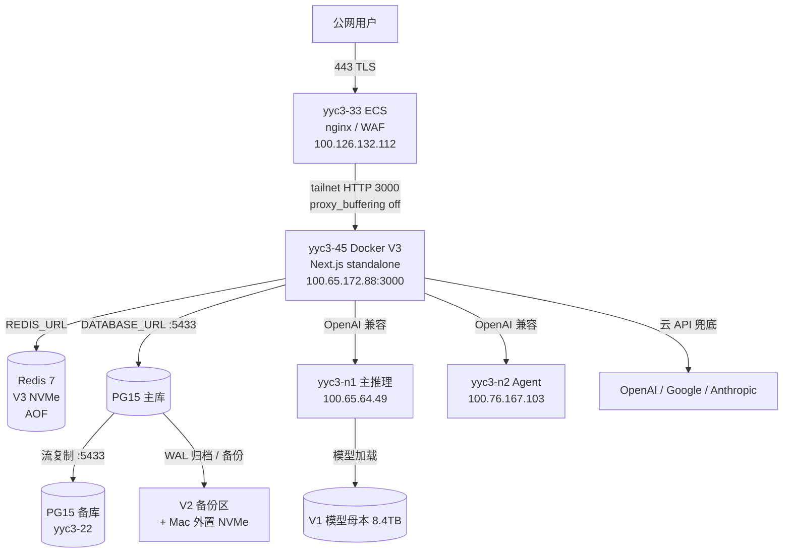

# YYC³ Agent Builder 集群拓扑与部署映射

> **_YYC³_**（YanYuCloudCube™ · 注册商标）
> _言启象限 | 语枢未来_
> **_Words Initiate Quadrants, Language Serves as Core for Future_**
> _万象归元于云枢 | 深栈智启新纪元_
> **_All things converge in cloud pivot; Deep stacks ignite a new era of intelligence_**

---

## 一、设备矩阵（只读事实）

| 节点 | 角色 | 关键规格 | Tailscale |
| --- | --- | --- | --- |
| **yyc3-22** MacBook M4 Max | 主控 + 全家族主库 | 128GB / 16P+40E / 2T+2T SN850X | `100.87.159.21` |
| **yyc3-45** NAS F4-423 | 存储 + 数据库 + GitBucket + API 网关 | 32GB / V1 14.5T(67%) / V2 1.5T(19%) / V3 NVMe 1.9T(9%) | `100.65.172.88` |
| **yyc3-n1** DGX Spark GB10 | 主推理 | GB10 Blackwell | `100.65.64.49` |
| **yyc3-n2** DGX Spark GB10 | Agent + 辅助推理 | GB10 Blackwell | `100.76.167.103` |
| **yyc3-33** ECS | 公网网关 | 4C / 8GB / cn-beijing | `100.126.132.112` |
| **yyc3-77** iMac M4 | 冷备 / 演练 | 32GB / 10P+10E / 1T+2T | `100.98.206.18` |
| **yyc3-66** Mate Pro | Win 测试机 | Ultra7-155H / 32GB / 1TB | `100.89.36.47` |

> 数据库：PG15 主备，**本机（yyc3-22）主、NAS（yyc3-45）辅**，双端 `5433`。

## 二、推荐落位（应用视角）

| 服务 | 落位 | 理由 |
| --- | --- | --- |
| Next.js 应用（容器） | **yyc3-45 V3 NVMe** | 7×24 常开、贴近 Redis/PG 备库、V3 为 NVMe |
| Redis（限流） | **yyc3-45 V3**（compose 内置） | 与 app 同机，亚毫秒级；AOF 持久化 |
| PG15 主库 | **建议调整为 yyc3-45**（见 §四） | app 与主库同机，避免依赖笔记本休眠 |
| PG15 备库 | **yyc3-22**（流复制） | 128GB 内存 + NVMe，适合做只读/分析/DR |
| 公网入口 / TLS | **yyc3-33 ECS** | 只暴露 443，反代到 tailnet 内 app，关闭 SSE 缓冲 |
| 主推理 | **yyc3-n1** | GB10 主力；OpenAI 兼容端点 |
| Agent / 辅助推理 | **yyc3-n2** | 与主推理隔离，避免互相挤占 |
| 模型母本 | **yyc3-45 V1** | 8.4TB 冷数据，HDD 足够 |
| GitBucket / 部署树 | **yyc3-45 V2** | 已有，保留 |
| 冷备 / 演练 | **yyc3-77** | 季度故障演练、浏览器兼容复测 |
| Windows 兼容测试 | **yyc3-66** | Edge / Chrome / 缩放 / 输入法 |

## 三、网络与数据流



## 四、三个必须先纠正的架构点

### 4.1 PG 数据盘选型：V2 是 HDD RAID6，不适合做主库数据盘

V2 为 `4×8T HDD RAID6`，随机写 IOPS 与延迟远逊于 NVMe。PG 的 WAL 写入、检查点、索引更新对随机 IO 敏感，直接把主库数据放在 V2 会成为应用 P95 的硬瓶颈。

**建议**：

| 数据 | 建议位置 | 说明 |
| --- | --- | --- |
| PG `PGDATA` | **V3 NVMe RAID1**（当前仅 9% 使用） | 1.9T 足够；与 app/Redis 同机 |
| PG `pg_wal` | V3 NVMe（与 PGDATA 同盘即可） | 避免 WAL 与数据分盘带来的额外复杂度 |
| 基础备份 / WAL 归档 | **V2**（HDD 容量大） | 保留 7–14 天；`archive_command` 异步 |
| 模型母本 | V1 | 冷数据，HDD 足够 |

> 若坚持 PG 数据放 V2，应至少把 `pg_wal` 放 V3，并把 `random_page_cost` 调到 1.1–1.5、`effective_io_concurrency` 提高；但仍不推荐作为生产主库盘。

### 4.2 主备方向与「app 在哪」必须一起决策

当前「yyc3-22 主、yyc3-45 辅」，而 app 计划跑在 yyc3-45：

| 方案 | 写路径 | 可用性 | 结论 |
| --- | --- | --- | --- |
| A. 保持 22 主、45 备，app 在 45 | 45 → tailnet → 22（约 1–3ms 局域网） | **依赖 Mac 不休眠**；macOS 更新/重启即写失败 | 仅适合开发/演示 |
| B. **45 主、22 备**，app 在 45 | 本机写入，零跨机延迟 | NAS 常开；22 作为只读/DR | **推荐（生产）** |
| C. app 也跑在 22，45 仅存储 | 本机写入 | Mac 仍是单点，且 Docker Desktop 资源争抢 | 不推荐 |

**建议采用 B**：把 NAS 提升为主库，Mac 作为流复制备库与只读分析节点；`DATABASE_URL` 指向 `100.65.172.88:5433`，`DATABASE_REPLICA_URL` 指向 `100.87.159.21:5433`。若业务坚持 A，则必须给 Mac 配置 `pmset` 禁止休眠 + UPS，并接受 macOS 维护窗口的写中断。

### 4.3 V1/V2 同属一个 RAID6 池，备份不能只留在 NAS

V1（模型母本）与 V2（PG/GitBucket）标注为「共享存储池」，意味着**同一组 4×8T HDD**。池故障会同时带走模型、数据库与备份。必须做异机备份：

1. PG 基础备份 + WAL 归档 → V2（短期）；
2. 每周全量 → **yyc3-22 外置 2T SN850X**（异机）；
3. 每月冷备 → 对象存储（OSS/S3）或 yyc3-77；
4. 每季度在 yyc3-77 做一次「无 NAS」恢复演练。

## 五、PG15 主备与 5433

**待确认**：「双端口 5433」指两台主机各监听 5433，还是同机双实例/PgBouncer 端口？本方案按「两台主机各 5433」设计；若同机双实例，需改第二个实例为 5434 并明确端口映射。

**关键参数（NAS 32GB，PG 建议 8GB 共享内存）**：

```conf
# postgresql.conf（NAS 主库，32GB 机器，与应用/Redis 共存）
listen_addresses = '0.0.0.0'          # 仅 tailnet + 防火墙限制
port = 5433
max_connections = 200
shared_buffers = 8GB
effective_cache_size = 16GB
work_mem = 32MB
maintenance_work_mem = 1GB
wal_level = replica
max_wal_senders = 10
wal_keep_size = 2GB
synchronous_commit = remote_write     # 至少一个备库确认；可用 local 降级
hot_standby = on
random_page_cost = 1.1                # NVMe
effective_io_concurrency = 200
```

**复制与故障切换**：

```bash
# 备库（yyc3-22）状态
pg_isready -h 100.65.172.88 -p 5433
psql -h 100.65.172.88 -p 5433 -c "select client_addr, state, sync_state from pg_stat_replication;"

# 主库故障时提升备库（手工最小方案）
pg_ctl promote -D /path/to/pgdata
# 然后切换 DATABASE_URL 并重启 app；建议后续引入 Patroni + etcd（witness 可放 yyc3-33 或 DGX）
```

**防脑裂**：禁止双主；`primary_conninfo` 使用 `application_name=yyc3-22`；引入 Patroni 时确保 etcd 为 3 节点（NAS + Mac + ECS/DGX 见证），否则网络分区下可能双主。

**连接池**：app 侧 `DATABASE_POOL_MAX=10`；若多实例，前置 PgBouncer（transaction 模式），端口 6432，PG 直连端口仅对内网开放。

## 六、Redis 落位

- 与应用同机（V3 NVMe），`REDIS_URL=redis://redis:6379/0`；
- `appendonly yes`、`maxmemory 512mb`、`maxmemory-policy noeviction`（限流键不允许被淘汰）；
- 不暴露宿主机端口，仅 compose 内网；
- 若未来 app 扩到多机，Redis 仍留在 NAS，其他节点通过 tailnet 连接；
- 备选：Upstash REST（`UPSTASH_REDIS_REST_URL/TOKEN`），代码已支持，优先级低于 `REDIS_URL`。

## 七、推理节点与模型

| 项 | 建议 |
| --- | --- |
| 主推理 | `http://100.65.64.49:8000/v1`（vLLM）或 `:11434`（Ollama），OpenAI 兼容 |
| Agent | `http://100.76.167.103:8000/v1`，与主推理隔离 |
| 云兜底 | OpenAI / Google / Anthropic（现有 AI SDK provider） |
| 模型母本 | V1 8.4TB；DGX 通过内网拉取，避免重复下载 |
| 应用接入 | 后续在 `model-resolver` 增加 `local/` 前缀 → `createOpenAI({ baseURL })`；当前先走云 API |

> 注意：GB10 为统一内存架构，跑大模型时需与宿主内存规划一起评估；本文件不假设具体显存容量（待补充）。

## 八、容量与资源分配（NAS 32GB）

| 组件 | 内存预算 | 说明 |
| --- | --- | --- |
| PG15 主库 | 8–10GB | `shared_buffers 8GB` + 连接/排序开销 |
| Redis | 0.5–0.8GB | `maxmemory 512mb` + 开销 |
| Next.js app | 1–2GB | SSE 长连接与并发执行 |
| GitBucket / 其他 | 4–6GB | 现有服务 |
| 系统与页缓存 | 剩余 | 留 4GB 以上余量，避免 OOM |

磁盘：V3 NVMe 1.9T（9%）足够放 PG + Redis + 镜像；V2 只放备份与 GitBucket；V1 放模型母本。

## 九、安全边界

1. **公网只开 ECS 443**；ECS 反代到 `100.65.172.88:3000`，禁止直接暴露 NAS 端口。
2. **PG/Redis 不监听公网**；仅 tailnet + 主机防火墙；`pg_hba.conf` 限制 `100.64.0.0/10`。
3. **Tailscale ACL**：仅 ECS → app:3000、app → PG:5433/Redis:6379、运维设备 → SSH；默认拒绝。
4. **密钥**：只在 `deploy/.env.production` 与平台 Secret；不写入镜像、文档、日志。
5. **SSE**：ECS nginx 必须 `proxy_buffering off`，否则执行面板会一次性输出。

## 十、上线前验证命令

```bash
# 1. tailnet 连通性
tailscale ping yyc3-45

# 2. 应用健康
curl -fsS http://100.65.172.88:3000/api/health
# 期望：status=ok，rateLimitStore=redis

# 3. Redis 限流
docker exec -it yyc3-agent-builder-redis-1 redis-cli ping
docker exec -it yyc3-agent-builder-redis-1 redis-cli zcard yyc3:ratelimit:127.0.0.1

# 4. PG 主备
pg_isready -h 100.65.172.88 -p 5433
psql -h 100.65.172.88 -p 5433 -c "select * from pg_stat_replication;"

# 5. SSE 流式（应逐行输出）
curl -N -X POST http://100.65.172.88:3000/api/execute-workflow \
  -H "Content-Type: application/json" -H "x-workflow-token: $TOKEN" \
  -d '{"nodes":[{"id":"n1","type":"start","position":{"x":0,"y":0},"data":{}}],"edges":[]}'
```

## 十一、待确认清单

- [ ] PG 主备方向：是否采纳「NAS 主、Mac 备」（影响 `DATABASE_URL` 与故障切换）
- [ ] 「双端口 5433」的确切含义（两台主机 / 同机双实例 / PgBouncer）
- [ ] PG 数据盘是否迁移到 V3 NVMe（建议迁移）
- [ ] Mac 是否允许作为生产主库（若坚持方案 A，需禁止休眠 + UPS）
- [ ] DGX 推理端点协议与端口（vLLM 8000 / Ollama 11434）与 GB10 可用显存
- [ ] NAS 与 Mac 之间链路带宽（模型拉取与 WAL 归档耗时）
- [ ] 备份目标：Mac 外置 NVMe 与对象存储的保留周期

---

## 变更历史

| 版本 | 日期 | 变更内容 | 作者 |
| ---- | ---- | -------- | ---- |
| v1.0.0 | 2026-11-11 | 基于设备矩阵建立落位、PG 主备、Redis 与推理方案 | YYC³ Team |

---

<p align="center">
  <b>YYC³</b>（YanYuCloudCube™ · 注册商标）<br>
  言启象限 | 语枢未来<br>
  <i>Words Initiate Quadrants, Language Serves as Core for Future</i><br>
  万象归元于云枢 | 深栈智启新纪元<br>
  <i>All things converge in cloud pivot; Deep stacks ignite a new era of intelligence</i><br>
  <sub>© 2026 YanYuCloudCube™（YYC³）· <a href="mailto:admin@0379.email">admin@0379.email</a></sub>
</p>
